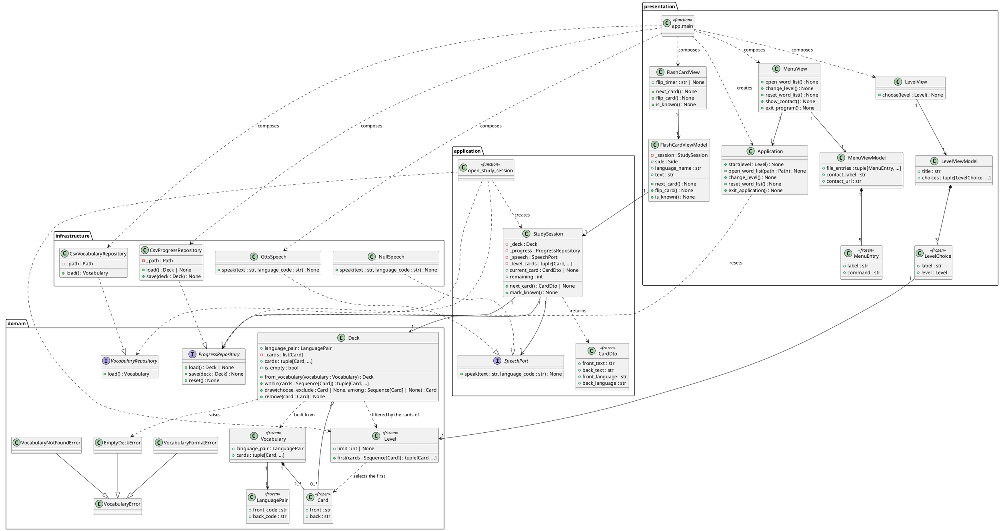

# Design Class Diagram: Flash Card

## Metadata
| Key | Value |
| --- | --- |
| ID | DCD-001 |
| CrossReference | [DM-001], [SD-001], [DICT-001], [ADR-0002], [ADR-0004] |

## Version History
| Date | Status | Author | Reviewer | Change | Commit |
| --- | --- | --- | --- | --- | --- |
| 2026-10-15 | Deprecated | Jens Tirsvad Nielsen | AI as stand-in for S01 | Scope note: runtime path rules and the executable build are packaging support, not design classes | [768ca34] |
| 2026-10-15 | Accepted | Jens Tirsvad Nielsen | AI as stand-in for S01 | Added the menu classes, Application and ProgressRepository.reset | pending |

---

## Purpose and Scope

The design classes of the program in `src/flash_card/`, in four layers (domain, application, infrastructure, presentation) with the presentation pattern MVVM ([ADR-0002]). The classes refine the concepts of [DM-001]; names are the IT terms of [DICT-001]. Methods trace to the operation contracts of [OC-001] and the sequence diagrams of [SD-001] (the SSD messages are in [SSD-001]). The module `flash_card/runtime.py` (where the resources and the data folder are when the program is frozen by PyInstaller) and the scripts in `tools/` are packaging support ([ADR-0004]): they have no system operation and are not design classes; `app.main` is still the only place that names the adapters, and it chooses the word list file.

## Diagram

## Class Table

| Class | Refines (Domain Model concept) | Responsibility | Attributes | Operations |
| --- | --- | --- | --- | --- |
| `Card` | Flash Card | Holds a word and its translation | `front`, `back` | none |
| `LanguagePair` | Word List (first and second language) | Names the two languages of a word list by code | `front_code`, `back_code` | none |
| `Level` | Level | Names how many of the first words of the word list a session uses and selects them | `limit` | `first` |
| `Vocabulary` | Word List | Holds all cards of a language pair as delivered | `language_pair`, `cards` | none |
| `Deck` | Words To Learn | Holds the cards still to learn and picks and removes cards | `language_pair`, `_cards` | `from_vocabulary`, `within`, `draw`, `remove` |
| `VocabularyRepository` | Word List | Port: load the delivered word list | none | `load` |
| `ProgressRepository` | Words To Learn | Port: load and save the words to learn | none | `load`, `save` |
| `StudySession` | Study Session | Runs one session: draws cards of the level, marks cards known, saves progress, asks for speech | `_deck`, `_progress`, `_speech`, `_level_cards`, `_current` | `next_card`, `mark_known` |
| `CardDto` | Flash Card | Plain data that crosses to the presentation layer | four text fields | none |
| `SpeechPort` | (none: external service) | Port: speak a text in a language | none | `speak` |
| `CsvVocabularyRepository`, `CsvProgressRepository` | Word List, Words To Learn | Adapters that read and write the semicolon separated CSV file | `_path` | `load`, `save` |
| `GttsSpeech`, `NullSpeech` | (none) | Adapters for speech: the gTTS service, and silence | none | `speak` |
| `FlashCardViewModel` | Study Session | Exposes the side, language name and text of the card shown, and the three commands | `_session`, `side`, `language_name`, `text` | `next_card`, `flip_card`, `is_known` |
| `LevelChoice`, `LevelViewModel` | Level | Plain data and view model of the level screen: the title and the three choices with their labels | `title`, `choices` | none |
| `MenuEntry`, `MenuViewModel` | (none: user interface) | Plain data and view model of the menu bar: the labels and the order of the File entries, the contact label and link | `file_entries`, `contact_label`, `contact_url` | none |
| `MenuView` | (none: user interface) | Draws the menu bar, asks the dialogs (file, confirmation, messages) and forwards the command | menus | `open_word_list`, `change_level`, `reset_word_list`, `show_contact`, `exit_program` |
| `Application` | Study Session | Holds the window, the word list and the progress in use; starts, drops and replaces sessions on level choice and menu commands | `root`, `view`, `exit_code` | `start`, `open_word_list`, `change_level`, `reset_word_list`, `exit_application` |
| `LevelView` | (none: user interface) | Draws the level screen and forwards the chosen level | buttons | `choose` |
| `FlashCardView` | (none: user interface) | Draws the window, forwards the buttons, owns the 3000 ms timer | `flip_timer`, widgets | `next_card`, `flip_card`, `is_known` |

## Method Traceability

| Method signature | Operation Contract / SD message |
| --- | --- |
| `open_study_session(vocabulary_repository, progress_repository, speech, choose, level) -> StudySession` | [OC-001] `chooseLevel`, [SD-001] sequence chooseLevel (loads the words to learn and the level's cards) |
| `Level.first(cards) -> tuple[Card, ...]`, `Deck.within(cards) -> tuple[Card, ...]` | [OC-001] `chooseLevel` postcondition (the level's cards); [SD-001] |
| `LevelViewModel.choices -> tuple[LevelChoice, ...]` | [OC-001] `startStudySession`; [SD-001] sequence startStudySession |
| `Application.open_word_list(path) -> None` | [OC-001] `openWordList`; [SD-001] sequence openWordList |
| `Application.change_level() -> None` | [OC-001] `changeLevel` |
| `Application.reset_word_list() -> None`, `ProgressRepository.reset() -> None` | [OC-001] `resetWordList`; [SD-001] sequence resetWordList |
| `MenuView.show_contact() -> None` | [OC-001] `showContact` |
| `Application.exit_application() -> None`, `MenuView.exit_program() -> None` | [OC-001] `exit` |
| `LevelView.choose(level) -> None` | [OC-001] `chooseLevel` (forwards the level to the composition root) |
| `StudySession.next_card() -> CardDto \| None` | [OC-001] `chooseLevel` (first card), `markUnknown`; [SD-001] |
| `StudySession.mark_known() -> None` | [OC-001] `markKnown` (remove and save); [SD-001] |
| `FlashCardViewModel.next_card() -> None` | [OC-001] `markUnknown`; [SD-001] |
| `FlashCardViewModel.is_known() -> None` | [OC-001] `markKnown`; [SD-001] |
| `FlashCardViewModel.flip_card() -> None` | [SSD-001] timer turn-over (no contract: started by the system's timer) |
| `FlashCardView.next_card()`, `.is_known()`, `.flip_card()` | the same three operations, forwarded from buttons and the timer; names are the assignment's |

## Pattern Annotations

| Pattern | Classes | Rationale |
| --- | --- | --- |
| Repository | `VocabularyRepository`, `ProgressRepository`, CSV adapters | The domain does not know the CSV file |
| Ports and adapters | `SpeechPort`, `GttsSpeech`, `NullSpeech` | Speech is an optional extra; the core runs without it |
| Null Object | `NullSpeech` | No `if speech:` checks in the use case |
| MVVM | `FlashCardView`, `FlashCardViewModel`, `LevelView`, `LevelViewModel`, `MenuView`, `MenuViewModel` | Behaviour is tested without Tkinter ([ADR-0002]) |
| Composition root | `app.main` | The one place that names the adapters, shows the level screen and chooses the word list file (beside the executable, else inside it) |
| Controller (GRASP) | `Application` | One object receives the menu and level commands and coordinates repositories and sessions |
| Value object | `Level`, `Card`, `LanguagePair` | Immutable data with its own rule (`Level.first`) |

## Dependency Check

Imports point inward: `domain` imports nothing from the other packages; `application` imports `domain`; `infrastructure` imports `application` and `domain`; `presentation` imports `application` and `domain`, and `app.main` additionally imports `infrastructure`. There is no cycle. `constants.py` imports nothing from the packages.

---

[DM-001]: ./domain-model.md
[DICT-001]: ./dictionary.md
[SSD-001]: ./uc-001/ssd.md
[OC-001]: ./uc-001/oc.md
[SD-001]: ./uc-001/sd.md
[ADR-0002]: ./adr/adr-0002-clean-architecture-and-mvvm.md
[ADR-0004]: ./adr/adr-0004-pyinstaller-executable.md
[768ca34]: https://git.tirsystem.com/Tirsvad-Udemy-100-days-of-code/031-flash-card/commit/768ca344c95d4f21e565e37ac96661c2f8dc8f54
