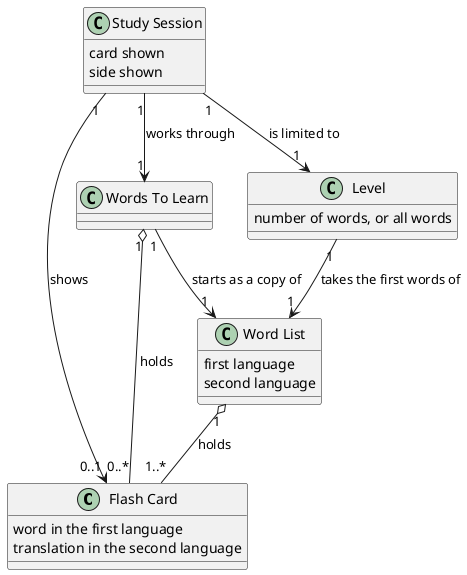

# Domain Model: Flash Card

## Metadata
| Key | Value |
| --- | --- |
| ID | DM-001 |
| CrossReference | [UC-001], [UCD-001], [SSD-001], [DICT-001] |
| Language | en |
| Domain | it |

## Version History
| Date | Status | Author | Reviewer | Change | Commit |
| --- | --- | --- | --- | --- | --- |
| 2026-10-14 | Deprecated | Jens Tirsvad Nielsen | AI as stand-in for S01 | Initial version | [c3fbcbc] |
| 2026-10-14 | Accepted | Jens Tirsvad Nielsen | AI as stand-in for S01 | Added the concept Level | [0b983b7] |

---

## Purpose and Scope

Covers: [UC-001] Study Flash Cards. The model holds the concepts a Learner talks about: the flash card, the word list, the words to learn, the level and the study session. The project-level model is this document; no other use case exists.

## Diagram

Concepts, attributes and associations only — no operations.

## Concept Table

| Concept | Definition | Attributes | Source (use case / glossary) |
| --- | --- | --- | --- |
| Flash Card | A word in one language with its translation in another | word, translation | UC-001 steps 3 and 4 ("card", "translation") |
| Word List | The complete set of flash cards of a language pair, as delivered with the program | first language, second language | UC-001 step 2 ("word list") |
| Words To Learn | The flash cards the Learner does not yet know; starts as the word list and only gets smaller | none | UC-001 steps 2 and 6 ("words to learn") |
| Level | The part of the word list a study session uses: its first 100 or 1000 words, or all words | number of words, or all words | UC-001 steps 2, 3 and 5 ("level") |
| Study Session | One run of the program in which the Learner is shown cards | card shown, side shown | UC-001 main scenario |

## Association Table

| From | Association (reading direction) | To | Multiplicity |
| --- | --- | --- | --- |
| Word List | holds | Flash Card | 1 to 1..* |
| Words To Learn | holds | Flash Card | 1 to 0..* |
| Words To Learn | starts as a copy of | Word List | 1 to 1 |
| Study Session | works through | Words To Learn | 1 to 1 |
| Study Session | shows | Flash Card | 1 to 0..1 |
| Study Session | is limited to | Level | 1 to 1 |
| Level | takes the first words of | Word List | 1 to 1 |

## Generalizations

| General | Specializations | Is-a justification |
| --- | --- | --- |
| none | none | no generalization exists in this domain |

---

[UC-001]: ./uc-001/uc.md
[UCD-001]: ./use-case-diagram.md
[SSD-001]: ./uc-001/ssd.md
[DICT-001]: ./dictionary.md
[c3fbcbc]: https://git.tirsystem.com/Tirsvad-Udemy-100-days-of-code/031-flash-card/commit/c3fbcbcfaf799e0ae34aed7e14d3bc8a62f03db3
[0b983b7]: https://git.tirsystem.com/Tirsvad-Udemy-100-days-of-code/031-flash-card/commit/0b983b7fdadf6958717c1d0227d0f2ebe037f7b1
