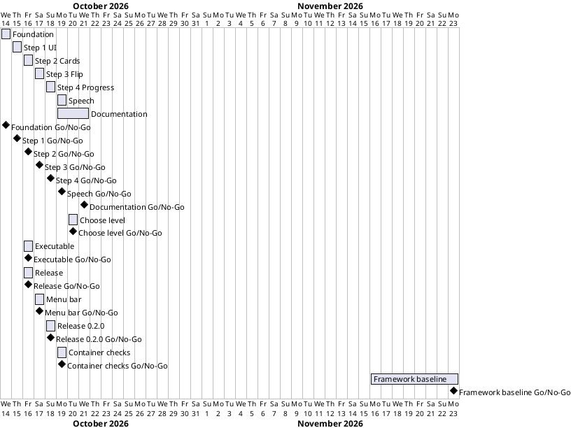

# Project Plan: Flash Card

## Metadata
| Key | Value |
| --- | --- |
| ID | PP-001 |
| CrossReference | [BC-001], [SA-001], [US-001], [MIL-001], [MIL-002], [MIL-003], [MIL-004], [MIL-005], [MIL-006], [MIL-007], [MIL-008], [MIL-009], [MIL-010], [MIL-011], [MIL-012], [MIL-013], [MIL-014] |
| Language | en |
| Domain | education |

## Version History
| Date | Status | Author | Reviewer | Change | Commit |
| --- | --- | --- | --- | --- | --- |
| 2026-10-15 | Deprecated | Jens Tirsvad Nielsen | AI as stand-in for S01 | Added gateway MIL-012 Release v0.2.0 (new request of S01) | [0264b60] |
| 2026-10-15 | Deprecated | Jens Tirsvad Nielsen | AI as stand-in for S01 | Added gateway MIL-013 Container checks (new request of S01) | [f86bc91] |
| 2026-11-16 | Accepted | Jens Tirsvad Nielsen | AI as stand-in for S01 | Added the baseline gateway MIL-014 with its schedule row, scope coverage, dependency, risk and Gantt entries and the No-Go rule; linked the milestones MIL-008 to MIL-013 to their git host milestones; stated why some gateways have no user story; corrected the number of phases in the Purpose; recorded the open issues found in the review; set the domain to education; reviewed in autonomous mode, not independent | pending |

---

## Purpose

This plan schedules the phases (gateways) that deliver the flash card program: the first seven inside the delivery window of one week that the Business Case sets as a constraint (2026-10-14 to 2026-10-21), the six later requests of the Product Owner (MIL-008 to MIL-013) and the baseline gateway [MIL-014], which has its own week, 2026-11-16 to 2026-11-23. Each phase is one milestone and is delivered by one pull request, so the Product Owner (S01) can follow the work step by step.

## Planning Assumptions

- Week 1 starts 2026-10-14; the plan ends by 2026-10-21, per the Business Case constraint, except the baseline gateway [MIL-014] (next bullets).
- One phase takes one day; the last phase (documentation and publication) has three days because the wiki exists in three languages and the screenshots need the finished program.
- The baseline documents (Business Case, Stakeholder Analysis, Project Plan, use case documents, ADRs) are accepted before MIL-001 starts, in a pull request of their own.
- Phases 2 to 5 follow the four steps of the course assignment in order; phase 6 is the Product Owner's extra.
- S01 is owner and approving reviewer of every phase; in autonomous mode the AI acts as stand-in and the review records say so.
- The baseline gateway [MIL-014] starts 2026-11-16 and ends 2026-11-23, one week, as the Business Case assumption sets for that milestone. It was added to bring the finished project to the baseline of the framework (decision of S01).
- Each assumption above is a decision of S01 unless it names another source; the length of one day per phase is S01's planning figure.
- A gateway whose Stories column says `none` delivers no behaviour a user sees: it is the foundation, the documentation, the container checks or the baseline.

## Gateway Schedule

| Gateway | Document | Window | Decision date | Owner | Stories | Main deliverable | Milestone |
| --- | --- | --- | --- | --- | --- | --- | --- |
| Project foundation | [MIL-001] | 2026-10-14 | 2026-10-14 | S01 | none | pyproject, gitignore, skeleton, Doxyfile, first README, word list | [Milestone MIL-001][MS-001] |
| Step 1 - User interface | [MIL-002] | 2026-10-15 | 2026-10-15 | S01 | US-001.01 | The window with card and buttons | [Milestone MIL-002][MS-002] |
| Step 2 - New flash cards | [MIL-003] | 2026-10-16 | 2026-10-16 | S01 | US-001.02 | Random cards from the word list | [Milestone MIL-003][MS-003] |
| Step 3 - Flip the cards | [MIL-004] | 2026-10-17 | 2026-10-17 | S01 | US-001.03 | Flip after 3000 ms | [Milestone MIL-004][MS-004] |
| Step 4 - Save progress | [MIL-005] | 2026-10-18 | 2026-10-18 | S01 | US-001.04 | words_to_learn.csv | [Milestone MIL-005][MS-005] |
| Spoken Malay word | [MIL-006] | 2026-10-19 | 2026-10-19 | S01 | US-001.05 | Text to speech as optional extra | [Milestone MIL-006][MS-006] |
| Documentation and publication | [MIL-007] | 2026-10-19 to 2026-10-21 | 2026-10-21 | S01 | none | README, screenshots, wiki in 3 languages, description and topics | [Milestone MIL-007][MS-007] |
| Choose level | [MIL-008] | 2026-10-20 | 2026-10-20 | S01 | US-001.06 | A level choice (100, 1000, all words) before the cards; documents, wiki and screenshots updated | [Milestone MIL-008][MS-008] |
| Executable with PyInstaller | [MIL-009] | 2026-10-16 | 2026-10-16 | S01 | US-001.07 | One Windows executable that runs without Python, built by a script; documents, wiki and README updated | [Milestone MIL-009][MS-009] |
| Release v0.1.0 | [MIL-010] | 2026-10-16 | 2026-10-16 | S01 | US-001.08 | Tag v0.1.0 and a release with `flash-card.exe`, its checksum and release notes | [Milestone MIL-010][MS-010] |
| Menu bar | [MIL-011] | 2026-10-17 | 2026-10-17 | S01 | US-001.09 to US-001.12 | File menu (open word list, change level, reset word list, exit) and About menu (contact); documents, wiki and screenshots updated | [Milestone MIL-011][MS-011] |
| Release v0.2.0 | [MIL-012] | 2026-10-18 | 2026-10-18 | S01 | US-001.08 | Version 0.2.0, tag `v0.2.0` and a release with the menu bar, notes and, if the host accepts it, the executable | [Milestone MIL-012][MS-012] |
| Container checks | [MIL-013] | 2026-10-19 | 2026-10-19 | S01 | none | A Debian (GNOME) container and Windows Sandbox that run the tests, screenshots and the smoke tests without the host desktop | [Milestone MIL-013][MS-013] |
| Framework baseline | [MIL-014] | 2026-11-16 to 2026-11-23 | 2026-11-23 | S01 | none | The adopted framework release, the wiki in the framework's shape, the README, licence metadata, the updated traceability matrix and review records | [Milestone 544](https://git.tirsystem.com/Tirsvad-Udemy-100-days-of-code/031-flash-card/milestone/544) |



## Scope Coverage

| Business Case scope item | Gateway |
| --- | --- |
| Tkinter program with the assignment's function names | MIL-002, MIL-003, MIL-004, MIL-005 |
| Reading `data/ms-da.csv` | MIL-003 |
| Saving and using `words_to_learn.csv` | MIL-005 |
| Optional spoken Malay word | MIL-006 |
| `pyproject.toml`, `.gitignore`, `Doxyfile`, `.venv` instructions, `pytest`, `constants.py` | MIL-001 |
| README, screenshots, wiki in three languages | MIL-007 |
| Repository description and topics | MIL-007 |
| Choice of level (new request after MIL-007) | MIL-008 |
| Executable built with PyInstaller (new request after MIL-008) | MIL-009 |
| Release with the executable attached (new request after MIL-009) | MIL-010 |
| Menu bar with File and About menus (new request after MIL-009) | MIL-011 |
| Release v0.2.0 with the menu bar (new request after MIL-011) | MIL-012 |
| Debian container for tests and headless runs (new request after MIL-012) | MIL-013 |
| Framework documents of the baseline | Baseline pull request before MIL-001 |
| The baseline milestone: framework release, wiki shape, README, licence metadata, traceability matrix, review records | MIL-014 |

## Dependencies

```
Baseline → MIL-001 → MIL-002 → MIL-003 → MIL-004 → MIL-005 → MIL-006 → MIL-007 → MIL-008 → MIL-009 → MIL-010 → MIL-011 → MIL-012 → MIL-013 → MIL-014
```

A No-Go on a phase moves every later date by the days the rework takes; MIL-008 was added after MIL-007 and takes the unplanned day 2026-10-20, so no buffer is left inside the window; a No-Go moves the end date past 2026-10-21 and S01 decides whether to accept that. A No-Go on [MIL-014] leaves the program and the earlier gateways as they are; S01 decides the new date.

## Plan Risks

| Risk | Impact | Mitigation |
| --- | --- | --- |
| No display on the machine that runs the review, so the e2e tests skip | Window behaviour is checked by the view model tests only | The review record states whether the e2e tests ran; the screenshots in MIL-007 prove the window on a machine with a display |
| The git host's CI is not available | The publish workflows cannot run | Milestones are published with `sync-project.sh` and the wiki by SSH push (MIL-007) |
| The speech extra cannot be installed on the build machine | MIL-006 cannot be demonstrated end to end | The adapter is tested with fakes; the manual check is recorded as not done |
| A continuous integration (CI) check fails on the pull request of [MIL-014] | The merge is delayed past 2026-11-23 | The failure is fixed on the same branch and the checks run again; after three failed rounds on one cause the work stops and S01 decides (trace: success criterion 9 of [BC-001]) |

## Open Issues

- No Governance document (GOV): see ADR-0003. S01 is the only approver.
- The git host's `sync-milestones` workflow is not installed; whether to install it is S01's decision.
- Domain: since the baseline the plan, the Business Case, the traceability matrix and the baseline milestone have the domain `education`. The other documents (Stakeholder Analysis, milestones MIL-001 to MIL-013, Domain Dictionary, User Stories, Use Case, models, DCD, ADRs and review records) keep the domain `it` they were accepted with; they are not changed by the baseline, and a change of their domain would need a new review of each.
- Dependencies and dates: MIL-009 to MIL-013 carry dates (2026-10-16 to 2026-10-19) earlier than the date of MIL-008 (2026-10-20), on which MIL-009 depends. The dates are as accepted and agree with the milestone documents; they are not changed here. S01 decides whether to re-date them.

---

[BC-001]: ./business-case.md
[SA-001]: ./stakeholder-analysis.md
[US-001]: ./user-stories.md
[MIL-001]: ./milestones/mil-001-foundation.md
[MIL-002]: ./milestones/mil-002-step1-user-interface.md
[MIL-003]: ./milestones/mil-003-step2-new-flash-cards.md
[MIL-004]: ./milestones/mil-004-step3-flip-cards.md
[MIL-005]: ./milestones/mil-005-step4-save-progress.md
[MIL-006]: ./milestones/mil-006-malay-speech.md
[MIL-007]: ./milestones/mil-007-documentation-and-publication.md
[MIL-008]: ./milestones/mil-008-choose-level.md
[MIL-009]: ./milestones/mil-009-executable.md
[MIL-010]: ./milestones/mil-010-release.md
[MIL-011]: ./milestones/mil-011-menu-bar.md
[MIL-012]: ./milestones/mil-012-release-0-2-0.md
[MIL-013]: ./milestones/mil-013-container-checks.md
[MS-001]: https://git.tirsystem.com/Tirsvad-Udemy-100-days-of-code/031-flash-card/milestone/165
[MS-002]: https://git.tirsystem.com/Tirsvad-Udemy-100-days-of-code/031-flash-card/milestone/166
[MS-003]: https://git.tirsystem.com/Tirsvad-Udemy-100-days-of-code/031-flash-card/milestone/167
[MS-004]: https://git.tirsystem.com/Tirsvad-Udemy-100-days-of-code/031-flash-card/milestone/168
[MS-005]: https://git.tirsystem.com/Tirsvad-Udemy-100-days-of-code/031-flash-card/milestone/169
[MS-006]: https://git.tirsystem.com/Tirsvad-Udemy-100-days-of-code/031-flash-card/milestone/170
[MS-007]: https://git.tirsystem.com/Tirsvad-Udemy-100-days-of-code/031-flash-card/milestone/171
[MS-008]: https://git.tirsystem.com/Tirsvad-Udemy-100-days-of-code/031-flash-card/milestone/172
[MS-009]: https://git.tirsystem.com/Tirsvad-Udemy-100-days-of-code/031-flash-card/milestone/173
[MS-010]: https://git.tirsystem.com/Tirsvad-Udemy-100-days-of-code/031-flash-card/milestone/176
[MS-011]: https://git.tirsystem.com/Tirsvad-Udemy-100-days-of-code/031-flash-card/milestone/177
[MS-012]: https://git.tirsystem.com/Tirsvad-Udemy-100-days-of-code/031-flash-card/milestone/178
[MS-013]: https://git.tirsystem.com/Tirsvad-Udemy-100-days-of-code/031-flash-card/milestone/179
[0264b60]: https://git.tirsystem.com/Tirsvad-Udemy-100-days-of-code/031-flash-card/commit/0264b6084f26bac5af716ea71596ce3be961fec8
[f86bc91]: https://git.tirsystem.com/Tirsvad-Udemy-100-days-of-code/031-flash-card/commit/f86bc9136e7719fbcd049a4f803959019b7d2df3
[MIL-014]: ./milestones/mil-014-framework-baseline.md
