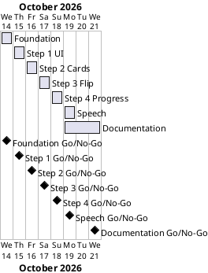

# Project Plan: Flash Card

## Metadata
| Key | Value |
| --- | --- |
| ID | PP-001 |
| CrossReference | [BC-001], [SA-001], [US-001], [MIL-001], [MIL-002], [MIL-003], [MIL-004], [MIL-005], [MIL-006], [MIL-007] |
| Language | en |
| Domain | it |

## Version History
| Date | Status | Author | Reviewer | Change | Commit |
| --- | --- | --- | --- | --- | --- |
| 2026-10-14 | Accepted | Jens Tirsvad Nielsen | AI as stand-in for S01 | Initial version | [c3fbcbc] |

---

## Purpose

This plan schedules the seven phases (gateways) that deliver the flash card program inside the delivery window of one week that the Business Case sets as a constraint (2026-10-14 to 2026-10-21). Each phase is one milestone and is delivered by one pull request, so the Product Owner (S01) can follow the work step by step.

## Planning Assumptions

- Week 1 starts 2026-10-14; the plan ends by 2026-10-21, per the Business Case constraint.
- One phase takes one day; the last phase (documentation and publication) has three days because the wiki exists in three languages and the screenshots need the finished program.
- The baseline documents (Business Case, Stakeholder Analysis, Project Plan, use case documents, ADRs) are accepted before MIL-001 starts, in a pull request of their own.
- Phases 2 to 5 follow the four steps of the course assignment in order; phase 6 is the Product Owner's extra.
- S01 is owner and approving reviewer of every phase; in autonomous mode the AI acts as stand-in and the review records say so.

## Gateway Schedule

| Gateway | Document | Window | Decision date | Owner | Stories | Main deliverable | Milestone |
| --- | --- | --- | --- | --- | --- | --- | --- |
| Project foundation | [MIL-001] | 2026-10-14 | 2026-10-14 | S01 | none | pyproject, gitignore, skeleton, Doxyfile, first README, word list | |
| Step 1 - User interface | [MIL-002] | 2026-10-15 | 2026-10-15 | S01 | US-001.01 | The window with card and buttons | |
| Step 2 - New flash cards | [MIL-003] | 2026-10-16 | 2026-10-16 | S01 | US-001.02 | Random cards from the word list | |
| Step 3 - Flip the cards | [MIL-004] | 2026-10-17 | 2026-10-17 | S01 | US-001.03 | Flip after 3000 ms | |
| Step 4 - Save progress | [MIL-005] | 2026-10-18 | 2026-10-18 | S01 | US-001.04 | words_to_learn.csv | |
| Spoken Malay word | [MIL-006] | 2026-10-19 | 2026-10-19 | S01 | US-001.05 | Text to speech as optional extra | |
| Documentation and publication | [MIL-007] | 2026-10-19 to 2026-10-21 | 2026-10-21 | S01 | none | README, screenshots, wiki in 3 languages, description and topics | |



## Scope Coverage

| Business Case scope item | Gateway |
| --- | --- |
| Tkinter program with the assignment's function names | MIL-002, MIL-003, MIL-004, MIL-005 |
| Reading `data/ms-da.csv` | MIL-003 |
| Saving and using `words_to_learn.csv` | MIL-005 |
| Optional spoken Malay word | MIL-006 |
| `pyproject.toml`, `.gitignore`, `Doxyfile`, `.venv` instructions, `pytest`, `constants.py` | MIL-001 |
| README, screenshots, wiki in three languages | MIL-007 |
| Repository description and topics | MIL-007 |
| Framework documents of the baseline | Baseline pull request before MIL-001 |

## Dependencies

```
Baseline → MIL-001 → MIL-002 → MIL-003 → MIL-004 → MIL-005 → MIL-006 → MIL-007
```

A No-Go on a phase moves every later date by the days the rework takes; the buffer is the 2026-10-20 working day, which has no phase of its own.

## Plan Risks

| Risk | Impact | Mitigation |
| --- | --- | --- |
| No display on the machine that runs the review, so the e2e tests skip | Window behaviour is checked by the view model tests only | The review record states whether the e2e tests ran; the screenshots in MIL-007 prove the window on a machine with a display |
| The git host's CI is not available | The publish workflows cannot run | Milestones are published with `sync-project.sh` and the wiki by SSH push (MIL-007) |
| The speech extra cannot be installed on the build machine | MIL-006 cannot be demonstrated end to end | The adapter is tested with fakes; the manual check is recorded as not done |

## Open Issues

- No Governance document (GOV): see ADR-0003. S01 is the only approver.
- The git host's `sync-milestones` workflow is not installed; whether to install it is S01's decision.

---

[BC-001]: ./business-case.md
[SA-001]: ./stakeholder-analysis.md
[US-001]: ./user-stories.md
[MIL-001]: ./milestones/mil-001-foundation.md
[MIL-002]: ./milestones/mil-002-step1-user-interface.md
[MIL-003]: ./milestones/mil-003-step2-new-flash-cards.md
[MIL-004]: ./milestones/mil-004-step3-flip-cards.md
[MIL-005]: ./milestones/mil-005-step4-save-progress.md
[MIL-006]: ./milestones/mil-006-malay-speech.md
[MIL-007]: ./milestones/mil-007-documentation-and-publication.md
[c3fbcbc]: https://git.tirsystem.com/Tirsvad-Udemy-100-days-of-code/031-flash-card/commit/c3fbcbcfaf799e0ae34aed7e14d3bc8a62f03db3
