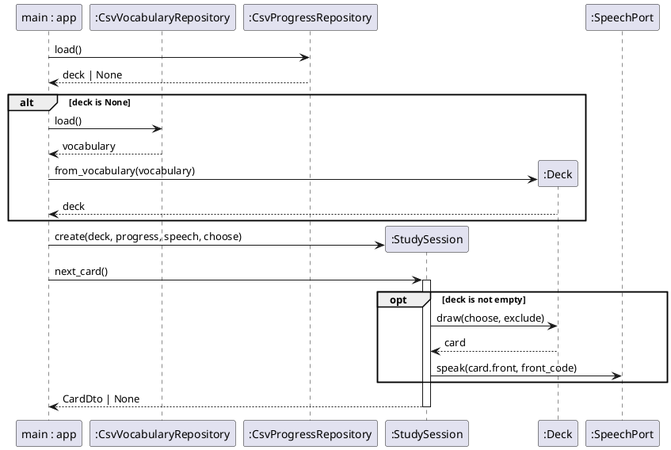
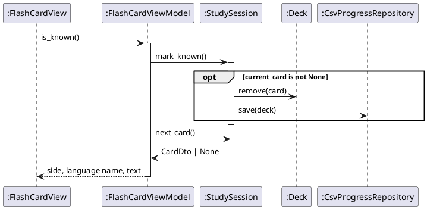
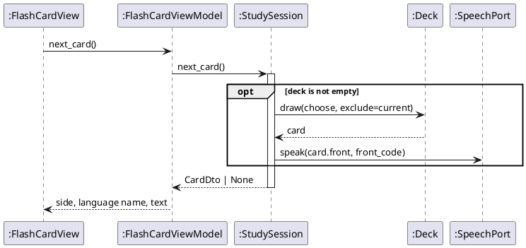

# Sequence Diagrams: Study Flash Cards

## Metadata
| Key | Value |
| --- | --- |
| ID | SD-001 |
| CrossReference | [OC-001], [DCD-001], [DICT-001] |

## Version History
| Date | Status | Author | Reviewer | Change | Commit |
| --- | --- | --- | --- | --- | --- |
| 2026-10-14 | Accepted | Jens Tirsvad Nielsen | AI as stand-in for S01 | Initial version | [c3fbcbc] |

---

## Sequence: startStudySession

**Realizes:** `startStudySession` in [OC-001]

### Diagram

### Pattern Annotations

| Pattern (GRASP / GoF) | Applied to | Rationale |
| --- | --- | --- |
| Creator | `app.main` creates `StudySession` | It holds the adapters the session needs |
| Information Expert | `Deck` draws and removes its own cards | It owns the list of cards |
| Null Object | `NullSpeech` as `SpeechPort` | The session never tests for speech |

### Postcondition Coverage

| Postcondition (from contract) | Satisfied by message |
| --- | --- |
| A `StudySession` instance was created | `create(deck, progress, speech, choose)` |
| A `Deck` was created from the progress file or a copy of the `Vocabulary` | `PR.load()`, `alt` fragment, `from_vocabulary` |
| `current_card` set and a `CardDto` returned, or `None` | `next_card()` with the `opt` fragment |

### Responsibility Check

The session coordinates, the deck holds the cards, the repositories hold the file format; no object receives all messages.

## Sequence: markKnown

**Realizes:** `markKnown` in [OC-001]

### Diagram

### Pattern Annotations

| Pattern (GRASP / GoF) | Applied to | Rationale |
| --- | --- | --- |
| MVVM | `FlashCardView`, `FlashCardViewModel` | The view raises the event and shows the result; the rule is behind the view model |
| Repository | `CsvProgressRepository` | The session stores the deck through a port |

### Postcondition Coverage

| Postcondition (from contract) | Satisfied by message |
| --- | --- |
| The card was removed from the `Deck` | `remove(card)` |
| The `Deck` was stored | `save(deck)` |
| `current_card` was set to `None` | `mark_known()` ends with no current card; `next_card()` then draws the next |

### Responsibility Check

The view model only sequences two session calls and maps the result for the view.

## Sequence: markUnknown

**Realizes:** `markUnknown` in [OC-001]

### Diagram

### Pattern Annotations

| Pattern (GRASP / GoF) | Applied to | Rationale |
| --- | --- | --- |
| Information Expert | `Deck.draw` | The deck knows its cards |

### Postcondition Coverage

| Postcondition (from contract) | Satisfied by message |
| --- | --- |
| A different card was chosen when two or more exist | `draw(choose, exclude=current)` |
| Deck and file unchanged | no `remove` or `save` message |
| The Malay word was passed to the `SpeechPort` | `speak(card.front, front_code)` |

### Responsibility Check

Same as `markKnown`; the session is the only object that speaks and draws.

---

[OC-001]: ./oc.md
[DCD-001]: ../dcd.md
[DICT-001]: ../dictionary.md
[c3fbcbc]: https://git.tirsystem.com/Tirsvad-Udemy-100-days-of-code/031-flash-card/commit/c3fbcbcfaf799e0ae34aed7e14d3bc8a62f03db3
