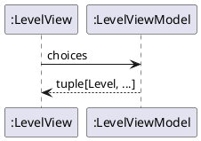
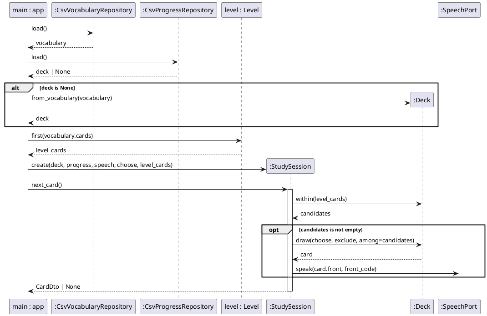
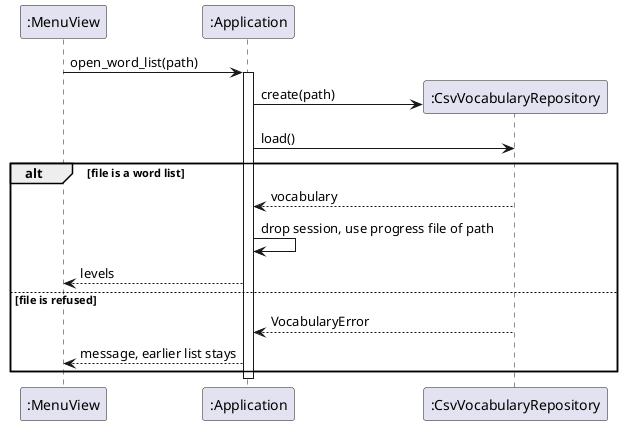
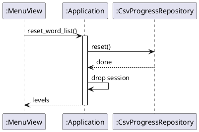
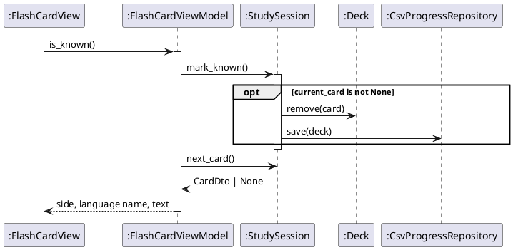
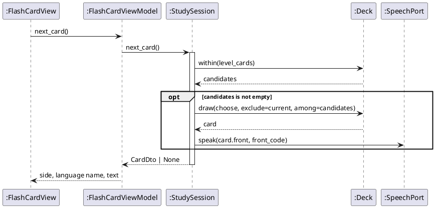

# Sequence Diagrams: Study Flash Cards

## Metadata
| Key | Value |
| --- | --- |
| ID | SD-001 |
| CrossReference | [OC-001], [DCD-001], [DICT-001] |

## Version History
| Date | Status | Author | Reviewer | Change | Commit |
| --- | --- | --- | --- | --- | --- |
| 2026-10-14 | Deprecated | Jens Tirsvad Nielsen | AI as stand-in for S01 | Added the sequences startStudySession (levels) and chooseLevel (level filter) | [0b983b7] |
| 2026-10-15 | Accepted | Jens Tirsvad Nielsen | AI as stand-in for S01 | Added the sequences openWordList and resetWordList | [2211d0f] |

---

## Sequence: startStudySession

**Realizes:** `startStudySession` in [OC-001]

### Diagram

### Pattern Annotations

| Pattern (GRASP / GoF) | Applied to | Rationale |
| --- | --- | --- |
| MVVM | `LevelView`, `LevelViewModel` | The view shows the choices; the labels and the order are in the view model |

### Postcondition Coverage

| Postcondition (from contract) | Satisfied by message |
| --- | --- |
| The three levels are returned in order | `choices` |
| No session or deck is created and no file is read | no other message is sent |

### Responsibility Check

The view model owns the choices; the view only draws buttons and forwards the click.

## Sequence: chooseLevel

**Realizes:** `chooseLevel` in [OC-001]

### Diagram

### Pattern Annotations

| Pattern (GRASP / GoF) | Applied to | Rationale |
| --- | --- | --- |
| Creator | `app.main` creates `StudySession` | It holds the adapters the session needs |
| Information Expert | `Level.first`, `Deck.within`, `Deck.draw` | The level knows its limit, the deck knows its cards |
| Null Object | `NullSpeech` as `SpeechPort` | The session never tests for speech |

### Postcondition Coverage

| Postcondition (from contract) | Satisfied by message |
| --- | --- |
| A `StudySession` was created and associated with the level | `create(deck, progress, speech, choose, level_cards)` |
| A `Deck` was created from the progress file or a copy of the `Vocabulary`, cards outside the level kept | `PR.load()`, `alt` fragment, `from_vocabulary` |
| The level's cards are the first N cards of the `Vocabulary` | `first(vocabulary.cards)` |
| `current_card` set and a `CardDto` returned, or `None`; the word was passed to the `SpeechPort` | `next_card()` with `within`, the `opt` fragment and `speak` |

### Responsibility Check

The composition root only wires; the level selects, the deck holds, the session coordinates; no object receives all messages.

## Sequence: openWordList

**Realizes:** `openWordList` in [OC-001]

### Diagram

### Pattern Annotations

| Pattern (GRASP / GoF) | Applied to | Rationale |
| --- | --- | --- |
| Controller | `Application` | Receives the menu command and coordinates the repositories and the session |
| Repository | `CsvVocabularyRepository` | The file format stays in the adapter |

### Postcondition Coverage

| Postcondition (from contract) | Satisfied by message |
| --- | --- |
| The vocabulary and the progress file of `path` are in use | `load()`, `use progress file of path` |
| The earlier session was dropped and the levels are returned | `drop session`, `levels` |
| A refused file leaves everything as it was | the `else` branch |

### Responsibility Check

The view forwards the command; the application validates through the repository before it replaces anything.

## Sequence: resetWordList

**Realizes:** `resetWordList` in [OC-001]

### Diagram

### Pattern Annotations

| Pattern (GRASP / GoF) | Applied to | Rationale |
| --- | --- | --- |
| Controller | `Application` | Sequences the reset and the return to the level screen |
| Repository | `CsvProgressRepository` | Knows where the progress file is |

### Postcondition Coverage

| Postcondition (from contract) | Satisfied by message |
| --- | --- |
| The progress file of the word list in use does not exist | `reset()` |
| The session was dropped and the levels are returned | `drop session`, `levels` |

### Responsibility Check

The confirmation is asked by the view before `reset_word_list` is called; the repository deletes only its own file.

## Sequence: markKnown

**Realizes:** `markKnown` in [OC-001]

### Diagram

### Pattern Annotations

| Pattern (GRASP / GoF) | Applied to | Rationale |
| --- | --- | --- |
| MVVM | `FlashCardView`, `FlashCardViewModel` | The view raises the event and shows the result; the rule is behind the view model |
| Repository | `CsvProgressRepository` | The session stores the deck through a port |

### Postcondition Coverage

| Postcondition (from contract) | Satisfied by message |
| --- | --- |
| The card was removed from the `Deck` | `remove(card)` |
| The `Deck` was stored | `save(deck)` |
| `current_card` was set to `None` | `mark_known()` ends with no current card; `next_card()` then draws the next |

### Responsibility Check

The view model only sequences two session calls and maps the result for the view.

## Sequence: markUnknown

**Realizes:** `markUnknown` in [OC-001]

### Diagram

### Pattern Annotations

| Pattern (GRASP / GoF) | Applied to | Rationale |
| --- | --- | --- |
| Information Expert | `Deck.draw` | The deck knows its cards |

### Postcondition Coverage

| Postcondition (from contract) | Satisfied by message |
| --- | --- |
| A different card of the level was chosen when two or more exist | `within(level_cards)`, `draw(choose, exclude=current, among=candidates)` |
| Deck and file unchanged | no `remove` or `save` message |
| The Malay word was passed to the `SpeechPort` | `speak(card.front, front_code)` |

### Responsibility Check

Same as `markKnown`; the session is the only object that speaks and draws.

---

[OC-001]: ./oc.md
[DCD-001]: ../dcd.md
[DICT-001]: ../dictionary.md
[0b983b7]: https://git.tirsystem.com/Tirsvad-Udemy-100-days-of-code/031-flash-card/commit/0b983b7fdadf6958717c1d0227d0f2ebe037f7b1
[2211d0f]: https://git.tirsystem.com/Tirsvad-Udemy-100-days-of-code/031-flash-card/commit/2211d0f4cbd8182314d18cbdefd939ae50c39e6d
