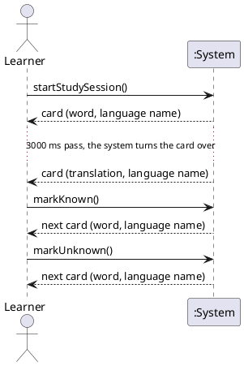

# System Sequence Diagram: Study Flash Cards

## Metadata
| Key | Value |
| --- | --- |
| ID | SSD-001 |
| CrossReference | [UC-001], [DM-001], [OC-001] |
| Language | en |
| Domain | it |

## Version History
| Date | Status | Author | Reviewer | Change | Commit |
| --- | --- | --- | --- | --- | --- |
| 2026-10-14 | Accepted | Jens Tirsvad Nielsen | AI as stand-in for S01 | Initial version | pending |

---

## Source Use Case

Study Flash Cards ([UC-001]) — scenario: main success scenario, with the unknown button as one repetition.

## Diagram

## System Operations

| Step | Message | Parameters | Return | Use case step |
| --- | --- | --- | --- | --- |
| 1 | startStudySession | none | card to show, or "nothing left to learn" | 1, 2, 3 |
| 2 | (timer) turn the card over | none | the same card, translation side | 4 |
| 3 | markKnown | none | next card, or "nothing left to learn" | 5, 6, 7 |
| 4 | markUnknown | none | next card | 5a, 7 |

The turn-over in step 2 is started by the system's own timer, not by a message from the Learner; it is shown as a return without a call, which is the one deviation from "every return answers a message".

## Alternate Flows

The extensions 2a, 3a, 5b and 7a of [UC-001] add no system operation of their own (they are errors, speech and timer handling inside the three operations above); their behaviour is in [OC-001] as exceptions. They are out of scope of this diagram, which shows the main success scenario with `markUnknown` as the one alternate answer.

## Lifecycle Notes

The system instance lives for one run of the program. The words to learn are created when the session starts and saved after each `markKnown`.

---

[UC-001]: ./uc.md
[DM-001]: ../domain-model.md
[OC-001]: ./oc.md
