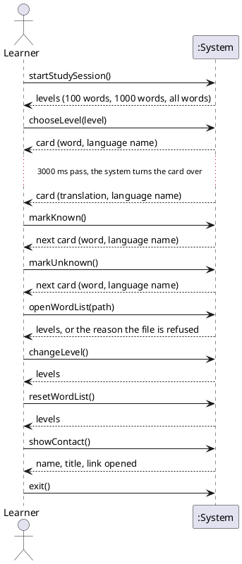

# System Sequence Diagram: Study Flash Cards

## Metadata
| Key | Value |
| --- | --- |
| ID | SSD-001 |
| CrossReference | [UC-001], [DM-001], [OC-001] |
| Language | en |
| Domain | it |

## Version History
| Date | Status | Author | Reviewer | Change | Commit |
| --- | --- | --- | --- | --- | --- |
| 2026-10-14 | Deprecated | Jens Tirsvad Nielsen | AI as stand-in for S01 | Added chooseLevel; startStudySession returns the levels | [0b983b7] |
| 2026-10-15 | Accepted | Jens Tirsvad Nielsen | AI as stand-in for S01 | Added the menu operations | [2211d0f] |

---

## Source Use Case

Study Flash Cards ([UC-001]) — scenario: main success scenario, with the unknown button as one repetition.

## Diagram

## System Operations

| Step | Message | Parameters | Return | Use case step |
| --- | --- | --- | --- | --- |
| 1 | startStudySession | none | the levels to choose from | 1, 2 |
| 2 | chooseLevel | level | card to show, or "nothing left to learn" | 3, 4, 5 |
| 3 | (timer) turn the card over | none | the same card, translation side | 6 |
| 4 | markKnown | none | next card, or "nothing left to learn" | 7, 8, 9 |
| 5 | markUnknown | none | next card, or "nothing left to learn" | 7a, 9 |
| 6 | openWordList | path of a CSV file | the levels, or the reason the file is refused | *a.1 |
| 7 | changeLevel | none | the levels | *a.2 |
| 8 | resetWordList | none (the Learner confirmed) | the levels | *a.3 |
| 9 | showContact | none | the author's name and title; the link is opened | *a.4 |
| 10 | exit | none | none; the program ends | *a.5 |

The turn-over in step 3 is started by the system's own timer, not by a message from the Learner; it is shown as a return without a call, which is the one deviation from "every return answers a message". When the level is given at start (extension 3a of [UC-001]) the Learner's first message is `chooseLevel` and `startStudySession` is not sent.

## Alternate Flows

The extensions 3a, 4a, 5a, 7b and 9a of [UC-001] add no system operation of their own (they are errors, speech, timer and level handling inside the operations above); their behaviour is in [OC-001] as exceptions. They are out of scope of this diagram, which shows the main success scenario with `markUnknown` as the one alternate answer.

## Lifecycle Notes

The system instance lives for one run of the program. The words to learn are created when the level is chosen and saved after each `markKnown`.

---

[UC-001]: ./uc.md
[DM-001]: ../domain-model.md
[OC-001]: ./oc.md
[0b983b7]: https://git.tirsystem.com/Tirsvad-Udemy-100-days-of-code/031-flash-card/commit/0b983b7fdadf6958717c1d0227d0f2ebe037f7b1
[2211d0f]: https://git.tirsystem.com/Tirsvad-Udemy-100-days-of-code/031-flash-card/commit/2211d0f4cbd8182314d18cbdefd939ae50c39e6d
