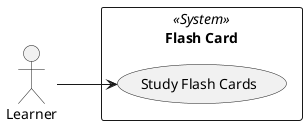

# Use Case Diagram: Flash Card

## Metadata
| Key | Value |
| --- | --- |
| ID | UCD-001 |
| CrossReference | [SA-001], [BC-001], [US-001], [UC-001] |
| Language | en |
| Domain | it |

## Version History
| Date | Status | Author | Reviewer | Change | Commit |
| --- | --- | --- | --- | --- | --- |
| 2026-10-14 | Accepted | Jens Tirsvad Nielsen | AI as stand-in for S01 | Initial version | [c3fbcbc] |

---

## Purpose and Scope

The system boundary is the flash card program: the window, the word list it reads, the progress file it writes and the optional spoken word. The Learner is the only actor. The git host, the course and the repository's readers are outside the boundary.

## Diagram

## Actor Table

| Actor | Stereotype | Stakeholder ID (SA) | Goals (use cases) |
| --- | --- | --- | --- |
| Learner | `<<Actor>>` | S01, S02 | Study Flash Cards |

## Use Case Table

| Use Case | Actor(s) | Goal |
| --- | --- | --- |
| Study Flash Cards | Learner | Learn the words of a word list by seeing each card, checking its translation and keeping only the words not yet known |

## Relationships

None. Hearing the Malay word is an extension flow of Study Flash Cards (see [UC-001]), not a use case of its own, because it has no goal apart from studying.

---

[SA-001]: ./stakeholder-analysis.md
[BC-001]: ./business-case.md
[US-001]: ./user-stories.md
[UC-001]: ./uc-001/uc.md
[c3fbcbc]: https://git.tirsystem.com/Tirsvad-Udemy-100-days-of-code/031-flash-card/commit/c3fbcbcfaf799e0ae34aed7e14d3bc8a62f03db3
